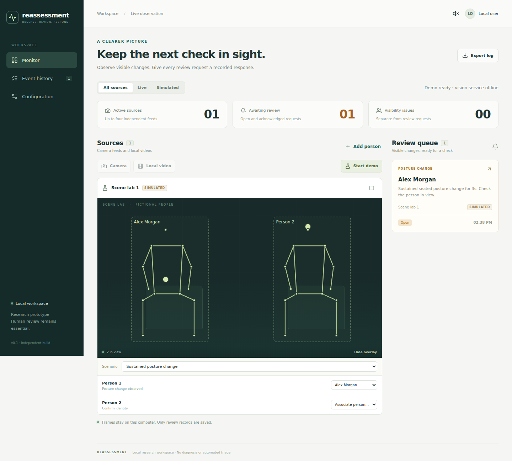

# Reassessment

A small local workspace for visible posture changes and human follow-up. Fresh implementation, fresh Git history; neither an upstream fork nor a merged copy of the two projects reviewed.



## Start

Requires **Node.js 24**. From this folder:

```sh
npm ci
npm start
```

Open **http://127.0.0.1:8790**. The complete simulated workflow works without credentials, Python, a camera, or cloud services. All runtime fonts and assets are local.

1. Select **Start demo**. Two fictional people appear.
2. Associate Person 1 with Alex Morgan.
3. Change the scenario to **Sustained posture change**. After the configured sustain window, a review request appears.
4. Open the request, acknowledge it, assign it, and record a reassessment outcome. Acknowledgment does not close the request or change initial nurse priority.
5. Find the resolved request in **Event history**, filter/search it, and export the log.
6. Try obscured landmarks or overlapping people. These produce visibility/identity issues separately from review requests.

## Camera and local video

The optional vision service needs **Python 3.11–3.13** and downloads CPU PyTorch plus YOLO11 Nano Pose weights. Allow roughly 1–2 GB of disk space for the isolated environment and dependencies.

```sh
npm run vision:setup
npm start
```

After the vision indicator becomes ready, add a camera or a local video. Up to four independent sources can be open, with at most six detections per source. Frame requests are bounded and processed at approximately two per second per source when hardware permits; busy frames are discarded, never queued indefinitely. Tracking state is isolated by source session.

The browser must permit camera access. Compatible video formats depend on the browser; MP4/H.264 and WebM are practical starting points. Video is processed during playback, not uploaded to a saved library. Raw frames are forwarded only to the local Python process and are not written to the database. After setup, baseline inference does not require network access.

YOLO and ByteTrack provide landmarks and anonymous tracking IDs. The server applies a simple sustained seated-posture rule. There is **no pulse/breathing estimator, diagnosis, crisis prediction, or automated triage**. Scores describe pose geometry, not medical probability. Use fictional records and consenting demonstration footage; this is not a clinical system.

## What was kept

| From the review                                   | Implemented here                                                                                                                                                 |
| ------------------------------------------------- | ---------------------------------------------------------------------------------------------------------------------------------------------------------------- |
| ED Physical AI: explicit identity and uncertainty | Manual patient association; clearing after ambiguity/visibility gaps; poor-quality suppression; session validation                                               |
| ED Physical AI: human response workflow           | Persisted acknowledgment, assignment, outcome/dismissal reason, initial priority preservation, audit log and restart tests                                       |
| VITAL: useful observation interface               | Multiple source cards, local video playback, pose overlays, review queue, searchable event history, optional browser alert sound                                 |
| Improvements over both                            | Separate SQLite tables, transactionally recorded events/actions, independent stream sessions, no global alert-dropping throttle, no remote inference credentials |

The three-tab structure is Monitor, Event history, and Configuration. No unused model-provider SDKs, placeholder physiological readings, external messaging worker, video storage subsystem, or retired Overshoot API is included. Browser sound is an optional attention cue; every review request remains in the persistent queue even when sound is muted or the page is closed.

## Development and checks

```sh
npm run check
npx playwright install --with-deps chromium
npm run test:browser
```

For hot reload, use two terminals: `npm run server` and `npm run dev`. The Vite development proxy targets the default application port 8790. Production startup builds the client, starts the local application, and starts the optional Python service if installed. `npm run server` alone does not start Python.

The browser check starts its own temporary application/database on port 18790, exercises the full simulated response workflow, checks mobile overflow and unexpected external requests, and saves screenshots under ignored `test-results/`. It does not use an actual camera or contact messaging services.

Optional shell environment variables:

| Variable            | Default                    | Purpose                                    |
| ------------------- | -------------------------- | ------------------------------------------ |
| `PORT`              | `8790`                     | Application port                           |
| `POSE_PORT`         | `8791`                     | Local Python service port                  |
| `DATA_PATH`         | `data/reassessment.sqlite` | SQLite file                                |
| `PYTHON`            | Automatically detected     | Python executable used during vision setup |
| `BROWSER_TEST_PORT` | `18790`                    | Temporary browser-check port               |

`.env.example` documents these names; values should be exported in your shell. No API keys are used. `data/`, `.venv/`, `.models/`, build output, test output, and dependencies are ignored by Git.

## Small architecture

- `shared/contracts.ts`: request validation and shared data types.
- `server/monitor.ts`: stream lifecycle, identity, quality gates, sustained rules and deduplication.
- `server/store.ts`: separate patient/event/audit/settings tables and transactional actions.
- `server/app.ts`: local API, explicit demo path, bounded pose proxy and export.
- `src/`: dashboard, source cards, review drawer and local presentation.
- `vision/service.py`: optional CPU inference, per-session ByteTrack instances, no recording.
- `tests/`: behavior and HTTP integration checks.

Events and audit records persist across restarts. Active streams and associations do not: restart a source and confirm identity again. Reloading the page ends browser capture; an existing source card explains that it needs to be stopped and added again. Events retain the name and association known at creation, rather than silently changing old records after reassociation. The API keeps all recorded events; the screen's recent activity list is limited to 100 entries, while export includes the stored history.

## Boundaries

This is a local, single-operator research tool. It has localhost binding, host/origin checks, JSON schemas and bounded frame work, but no login, authorization model, encryption at rest, hospital integration, retention policy or clinical validation. The operator label is an audit annotation, not a verified identity. A persistent queue is not proof of message delivery or staff response. Multiple feeds share CPU resources; actual capacity and identity reliability require tests on your footage.

The original projects inspired the feature selection. No upstream commits, branches or remotes were imported. See [dependency notices](docs/dependencies.md), [vision contract](docs/vision-contract.md), and [verification](docs/verification.md).
